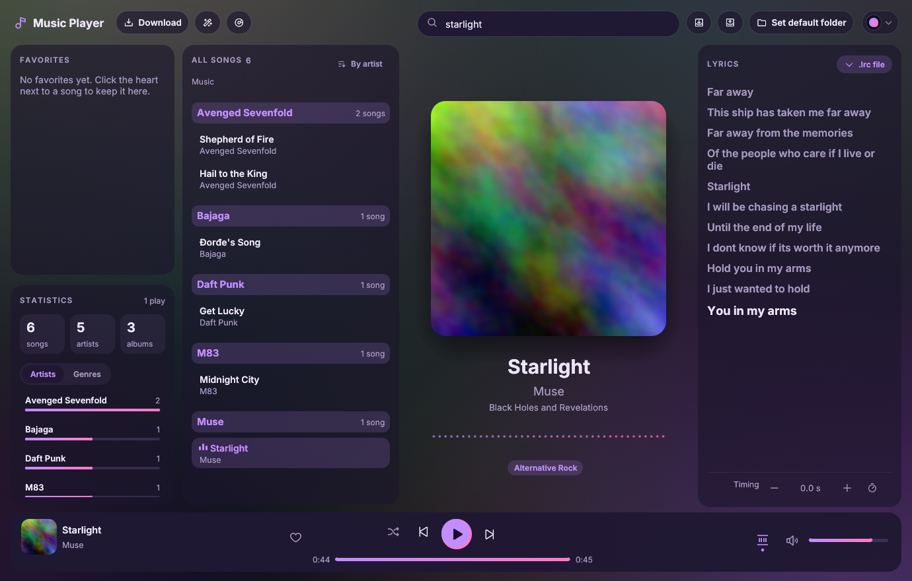
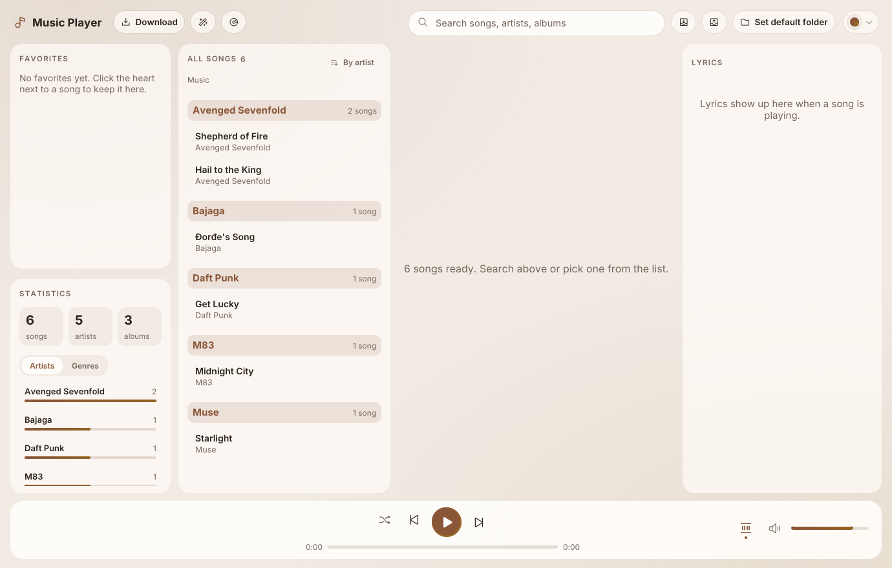

# Music Player

A music player for your own music folder, for Linux. Covers, timed lyrics you can fix
yourself, favorites, statistics, an equalizer, even volume between songs, downloads,
and 13 themes. One file, nothing to install.

Written in Rust with [egui](https://github.com/emilk/egui).

## Features

- **Your music folder**, read as it is, and watched: new songs show up by themselves.
  Names come from the songs' tags, or are worked out from messy file names
  (`Daft_Punk_-_Get_Lucky_(Official_Video)_[HD].mp3` becomes *Get Lucky* by
  *Daft Punk*).
- **Covers** from the song itself, its folder, or online (iTunes, Deezer, MusicBrainz).
- **Timed lyrics** that follow the song, from a `.lrc` file next to it, saved ones, or
  online (LRCLIB, YouTube Music, Genius, KuGou, NetEase). Lyrics that are a bit early
  or late can be moved (like a video player's subtitle delay); lyrics without timing
  get timed by tapping along. Lyrics on your computer always win over online ones.
- **Favorites, play counts and statistics** (songs per artist or genre).
- **Sorting and filters**: by title, artist, album, genre, recently added, most played.
- **Even volume**: every song at about the same loudness (EBU R128, the way streaming
  services do it), without changing the files.
- **An equalizer** under the song, and the cover's colors behind everything.
- **Editing**: titles, artists, albums and genres, written into the files' tags too.
  **Tidy file names** names every file "Artist - Title" (with undo). Duplicates are
  found, and the best copy suggested. Deleting goes to the Trash.
- **Albums and genres from Wikipedia**, suggested for songs that miss them.
- **Downloads** of songs and playlists from YouTube and many other sites, as
  "Artist - Title.mp3", three at a time.
- **Export and import** of the whole library as one .zip, to move to another computer.
- **13 themes**, light and dark. Media keys and the desktop's media controls work.

## Getting it

Download `MusicPlayer-x86_64.AppImage` from the
[releases](../../releases), make it executable once (right-click > Properties >
Permissions, or `chmod +x MusicPlayer-x86_64.AppImage`), and double-click it. It runs
on 64-bit Linux systems from 2022 on (Ubuntu 22.04, Mint 21, Debian 12, Fedora 36 or
newer).

On the first start it asks: **use an existing library** (a .zip made with Export, or a
folder with `library.json` in it) or **start fresh** (it opens your Music folder).
"Set default folder" picks another music folder.

Keys: Space plays and pauses, `/` jumps to the search box, G and H move timed lyrics
earlier and later, Escape closes menus.

## Where everything is kept

In `~/.local/share/music-player` (another place: start it with
`MUSIC_PLAYER_DATA=/some/folder`). Your music files change only when you ask: the
pencil, Tidy file names, and deleting (to the Trash).

| File | What's in it |
| --- | --- |
| `library.json` | One record per song: its names as shown, heart, plays, lyrics source, the names you changed |
| `settings.json` | Your default music folder |
| `preferences.json` | Theme, volume, sorting, shuffle, Even volume |
| `loudness.json` | How loud each song is, measured once |
| `wikipedia.json` | What Wikipedia said about each song |
| `covers/`, `lyrics/` | Covers found online, lyrics you saved |
| `last-rename.json` | The last renames, for "Undo last rename" |
| `backups/` | The library as it was before each import |
| `bin/` | yt-dlp, ffmpeg and deno, if the player downloaded them |

## Downloads

"Download" takes a link to a song or a playlist. It uses three free programs: yt-dlp
(finds the music, and updates itself, since sites change), ffmpeg (makes the mp3s) and
deno (reads YouTube's pages). Ones on the computer are used; otherwise "Get them"
downloads them once into `bin/` (about 250 MB). Please only download music you're
allowed to.

## Building

Needs [Rust](https://rustup.rs) (1.91 or newer), the ALSA headers
(`sudo apt install libasound2-dev pkg-config` on Debian and Ubuntu), curl and python3.

    cargo run --release        # try it
    cargo test --release       # the tests
    ./build-appimage.sh        # makes dist/MusicPlayer-x86_64.AppImage

Two tests need real files and are left out by default:
`MUSIC_PLAYER_TEST_MP3=song.mp3 MUSIC_PLAYER_TEST_AUDIO=song.m4a cargo test --release -- --ignored`
(the second also needs yt-dlp and ffmpeg). `MP_DEBUG=1` prints startup steps.

GitHub Actions builds and tests every push. Pushing a tag like `v1.0.0` makes a
release with the AppImage attached.

## The code

| File | What it does |
| --- | --- |
| `src/main.rs` | Opens the window |
| `src/app.rs` | What the app knows and does: playing, the queue, sorting, editing, downloads… |
| `src/ui.rs` | Everything on screen |
| `src/library.rs` | Finding songs, reading tags, noticing changes |
| `src/names.rs` | How songs get their names |
| `src/store.rs` | `library.json`, settings, preferences |
| `src/covers.rs` | Covers from the file, its folder, or online |
| `src/lyrics.rs` | Lyrics: sources, timing, tapping along, saving |
| `src/player.rs`, `src/analysis.rs`, `src/loudness.rs` | Sound, the equalizer, Even volume |
| `src/edit.rs` | Changing files: tags, renaming with undo, the Trash |
| `src/wiki.rs` | Albums and genres from Wikipedia |
| `src/downloads.rs` | Downloads with yt-dlp |
| `src/transfer.rs` | Export and import |
| `src/media.rs` | Media keys and the desktop's media controls |
| `src/theme.rs`, `src/genres.rs` | The 13 themes, genre names |
| `packaging/` | The AppImage's menu entry, and `weak-glibc.py` (lets it run on older systems) |

## Known limits

- `.webm` and `.opus` songs don't play yet (the audio decoder has no Opus support).
- Linux only for now.

## License

MIT, see [LICENSE](LICENSE). The font, icons and the downloaded tools have their own
licenses: see [THIRD-PARTY-NOTICES.md](THIRD-PARTY-NOTICES.md).
